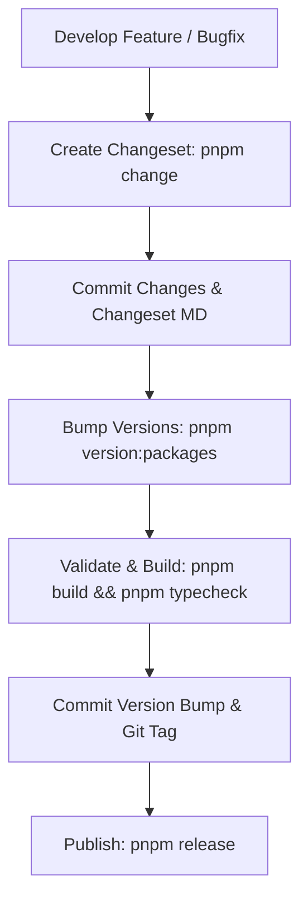

# Monorepo Release & Versioning Checklist 🥑

This document defines the semantic versioning and release protocol for the **LYGUA** monorepo using [Changesets](https://github.com/changesets/changesets).

---

## 📋 The Release Flowchart



---

## 🛠️ Step-by-Step Release Checklist

### 1. 📝 Step 1: Create a Changeset (During Development)
Whenever you make a functional update, bug fix, or new feature in one or more packages:
```bash
pnpm change
```
- **Select Packages:** Use spacebar / arrows to select which packages were modified.
- **Select Bump Type:**
  - `patch` — Bug fixes, internal refactoring, non-breaking performance tweaks.
  - `minor` — New backward-compatible features, new ponyfills, new CLI flags.
  - `major` — Breaking API changes, signature shifts, removals.
- **Summary:** Provide a short, user-facing summary of what changed.
- *Result:* Creates a temporary markdown file in `.changeset/*.md`. Commit this file alongside your code!

---

### 2. 🔢 Step 2: Version Packages (Pre-Release)
When you are ready to prepare a release:
```bash
pnpm version:packages
```
This command automatically:
1. Consumes all pending `.changeset/*.md` files.
2. Computes the next SemVer version for each modified package.
3. Cascades version bumps to all workspace dependents (e.g. bumping `@lygua/secure-random` auto-bumps `@lygua/crypto` and `lygua`).
4. Generates or updates `CHANGELOG.md` in each package directory.

---

### 3. 🧪 Step 3: Verify & Compile
Before publishing or tagging, guarantee that the entire monorepo builds cleanly:
```bash
pnpm typecheck
pnpm build
pnpm lint
```

---

### 4. 🚀 Step 4: Commit & Publish
1. Commit the version updates:
   ```bash
   git add .
   git commit -m "chore(release): bump package versions"
   ```
2. Publish to npm (or GitHub Packages):
   ```bash
   pnpm release
   ```
   *(Runs `turbo run build && changeset publish`)*
3. Push commits and tags to remote:
   ```bash
   git push --follow-tags
   ```

---

## ⚡ Quick Reference Commands

| Command | Action |
| :--- | :--- |
| `pnpm change` | Interactive prompt to declare a version bump and changelog message. |
| `pnpm version:packages` | Consumes changesets, updates `package.json` versions and changelogs. |
| `pnpm build` | Re-compiles all monorepo packages through Turbo & tsdown. |
| `pnpm typecheck` | Validates TypeScript types across all workspace packages. |
| `pnpm release` | Builds and publishes updated packages to the registry. |
